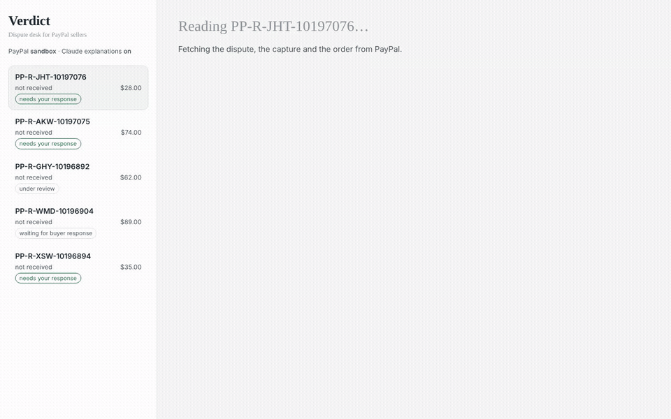

# Verdict — an honest dispute desk for PayPal sellers

A PayPal dispute lands. Most small sellers either refund everything (and leave money on the table) or fight everything (and lose time, fees, and sometimes the case). Verdict reads what PayPal already has on file — **seller protection on the capture, tracking on the order, the buyer's claim, and the actions PayPal allows right now** — and tells the seller whether to refund or respond, with what evidence, and why. After the seller confirms, it sends the response through PayPal's Disputes API.

Built for the PayPal AI Hackathon (Nov 2026). Runs against the PayPal **sandbox**.



## What it does

1. **Reads** the dispute, the capture (`seller_protection.status`), the order (ship-to address, trackers) and the carrier record. Nothing is typed in by hand.
2. **Decides** with a deterministic, policy-cited rule engine: `REFUND_NOW · RESPOND_WITH_EVIDENCE · OFFER_PARTIAL · REPLY_AND_WAIT · NO_ACTION_AVAILABLE`, with the rule ids that fired, the policy text behind each, an expected-value comparison, and a confidence level.
3. **Gates** every action on PayPal's own `links[]` / `allowed_response_options` — the only authoritative list of what is allowed at that moment. The engine never recommends an action PayPal would refuse (measured: 0% unsafe actions on 94 cases).
4. **Executes** only after a human confirms: `provide-evidence` (multipart with tracking + a generated evidence summary file), `accept-claim`, `make-offer`, `send-message`, `escalate`, `provide-supporting-info`. Every call is written to an audit log with the status transition it caused.
5. **Explains** in English or 中文 with Claude (optional) — the model can rewrite the explanation and the buyer note but never the verdict, and its output is checked against the evidence bundle for invented tracking numbers or contradictions.

A verdict is a **recommendation under PayPal's published policies**. PayPal makes the decision; Verdict never claims to predict it.

## Results

From `python -m eval.run` (94 cases: 2 captured from the sandbox, 77 synthetic bundles on the same schema, 15 messy/adversarial cases incl. prompt-injection in buyer messages). Ground truth is an independent decision table (`eval/oracle.py`) written from PayPal's policy pages and hand-reviewed — *what policy says the seller should do*, not what PayPal will decide.

| system | accuracy | unsafe-action rate | over-refund | under-refund |
|---|---|---|---|---|
| refund everything | 56% | 0% | 32% | 0% |
| fight everything PayPal lets you fight | 46% | 0% | 1% | 33% |
| trust `seller_protection` alone | 34% | **36%** | 9% | 27% |
| **Verdict (rules)** | **99%** | **0%** | 1% | 0% |

- *unsafe action*: recommending a PayPal call the dispute's links don't allow (PayPal returns `ACTION_NOT_ALLOWED_IN_CURRENT_DISPUTE_STATE`).
- *over-refund*: refunding when policy says respond/offer/wait. *under-refund*: contesting when policy says refund.
- The single Verdict miss is a $0 degenerate case. Full table, per-reason breakdown and every disagreement: [`eval/results.md`](eval/results.md).
- Live sandbox replay (2026-11-06): `send-message`, `provide-evidence` (multipart + file), `provide-supporting-info`, `escalate` all returned 200 and moved the dispute as the engine expected; see `docs/policy_sources.md` for the observed state machine.

## How it decides (short version)

```
links[] has no seller action?  → NO_ACTION_AVAILABLE (never refund blind)
INR  + protection covers INR + tracking to the PayPal address  → RESPOND_WITH_EVIDENCE (PROOF_OF_FULFILLMENT)
INR  + tracking to a different address                          → REFUND_NOW (not protected) unless signature proof
INR  + no tracking anywhere                                     → REFUND_NOW (fighting without proof ≈ 0 and costs a fee)
INR  + still in transit before the promised date                → REPLY_AND_WAIT (send tracking + date)
SNAD + listing/photos on hand                                   → RESPOND_WITH_EVIDENCE; else OFFER_PARTIAL; tiny amounts → refund
UNAUTH + protection covers it + shipped with tracking           → RESPOND_WITH_EVIDENCE; else REFUND_NOW
contest EV = p_keep × amount − handling cost ≤ 0                → REFUND_NOW dominates
```
Each rule carries its policy basis; see `verdict/engine.py` and `docs/policy_sources.md`. `p_keep` values are documented assumptions used to rank options, not calibrated probabilities.

## Run it

```bash
pip install -e .                         # Python 3.11+
cp .env.example .env                     # add PAYPAL_CLIENT_ID / PAYPAL_CLIENT_SECRET (sandbox app with Disputes + Transaction Search enabled)
uvicorn verdict.app:app --port 8787      # open http://localhost:8787
```
CLI: `python -m verdict.cli list` · `show <dispute_id>` · `execute <dispute_id> --yes`.
Tests: `pytest`. Evaluation: `python -m eval.generate_cases && python -m eval.run`.
Optional: set `ANTHROPIC_API_KEY` for Claude explanations and the `llm_only` baseline.

To create test disputes: pay a sandbox order from a sandbox *personal* account, then file "Report a problem → I haven't received the item" from that account's Activity page. The dispute reaches `WAITING_FOR_SELLER_RESPONSE` in ~2–3 minutes. (The documented `POST /v1/customer/disputes` sandbox endpoint rejected every documented body in our tests; details in `docs/policy_sources.md`.)

## PayPal + AI, concretely

- PayPal APIs used: Disputes v1 (list/get, provide-evidence, accept-claim, make-offer, send-message, escalate, provide-supporting-info), Payments v2 captures, Orders v2 (+ tracking), Shipment Tracking v1, Transaction Search v1. `verdict/paypal.py` is a thin client; `verdict/tools.py` exposes three toolkit-shaped tools (`list_disputes`, `get_dispute_verdict`, `execute_dispute_verdict`) for OpenAI/Anthropic/LangChain agents — the official Python Agent Toolkit (1.1.0) ships no dispute tools, so these are shaped to be upstreamable.
- AI: Claude (`claude-sonnet-5-5` by default) for explanations and buyer notes, behind a faithfulness check; the decision itself is deterministic on purpose — money decisions need rules you can read and test.

## Limitations (please read)

- The oracle is our reading of PayPal's policy pages. PayPal's adjudication uses signals no API exposes (buyer history, carrier scans, fraud models). We report policy-agreement, never win rates.
- Sandbox ≠ production: the sandbox dispute state machine is simplified and can't produce adjudication outcomes on demand.
- Synthetic cases vary six factors on a grid; real dispute data is messier and INR-heavy.
- Seller-side facts PayPal doesn't hold (signature proof, listing screenshots, return policy) are entered as checkboxes; Verdict can't verify them.
- One merchant, one currency per run; no chargeback-network (Visa/Mastercard) logic.

## Repo map

```
verdict/paypal.py     REST client; every write gated by require_link()
verdict/bundle.py     EvidenceBundle (normalized facts) + builder from raw PayPal JSON
verdict/engine.py     rules R0–R11, EV, policy citations
verdict/actions.py    executor + audit log
verdict/narrative.py  optional Claude explanation with faithfulness check
verdict/app.py        FastAPI API + static/index.html UI
verdict/tools.py      agent-framework tool definitions
eval/                 oracle.py (decision table), generate_cases.py, run.py, cases/, results.md
tests/                engine, client, multipart, fixtures from real sandbox JSON
```

MIT © 2026 Yiyao (Ella) Li
